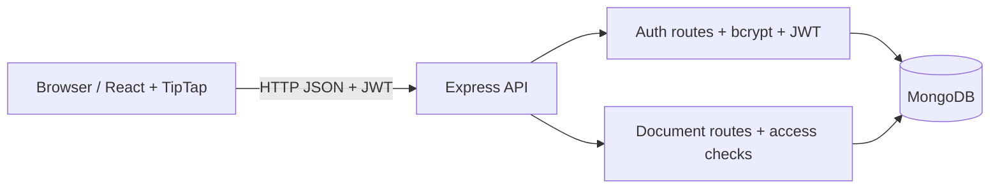

# CollabSpace — Real-Time Collaborative Document Editor

A MERN-style collaborative document editor starter with a React/Vite frontend, Express API, MongoDB persistence, JWT authentication, document CRUD, and collaborator permissions.

> **Implementation status:** Authentication, document CRUD, role-based document access, sharing invitations for registered users, rich-text editing, and debounced API saves are included. Real-time Yjs synchronization, live cursors, durable version history, comments, refresh-token rotation, OAuth, offline recovery, and multi-instance scaling are **not yet implemented**. Do not claim these features or performance metrics until they are built and tested.

## Requirements

- Node.js 20.19+ or 22.12+ recommended for current Vite releases
- npm
- MongoDB Community Server or a MongoDB Atlas database

## Quick start (Windows PowerShell)

1. Extract the ZIP and open PowerShell in the `collab-editor` folder.
2. Install packages:

   ```powershell
   npm install
   ```

3. Create `server/.env` by copying `server/.env.example`. Set a unique `JWT_SECRET` with at least 32 characters and configure `MONGODB_URI`.
4. Ensure MongoDB is running.
5. Start frontend and backend:

   ```powershell
   npm run dev
   ```

6. Open http://localhost:5173 and register an account.

Backend health check: http://localhost:5000/api/health

If the Vite port is different, update `CLIENT_URL` in `server/.env` to match the actual frontend origin.

## Quick start with Docker Compose

Run the entire multi-tier stack (MongoDB + Backend API & WebSocket Collaboration Server + React Nginx Client) with a single command:

```powershell
docker compose up --build
```

- **Frontend App**: http://localhost:5173
- **Express API**: http://localhost:5000/api/health
- **WebSocket CRDT Server**: ws://localhost:1234
- **MongoDB**: mongodb://localhost:27017

## Environment variables

| Variable | Where | Description |
|---|---|---|
| `PORT` | server | API port, default 5000 |
| `CLIENT_URL` | server | Allowed frontend origin |
| `MONGODB_URI` | server | MongoDB connection string |
| `JWT_SECRET` | server | Long random signing secret; never commit |
| `JWT_EXPIRES_IN` | server | JWT lifetime, default `1d` |
| `NODE_ENV` | server | Runtime environment |
| `VITE_API_URL` | client | API base URL |

Client environment variables are exposed to the browser bundle; never put secrets in `VITE_*` variables.

## Features implemented

- Register and log in with hashed passwords
- JWT-protected API
- Create, list, rename, edit, and delete owned documents
- Share with registered users as viewer or editor
- Viewer read-only checks on document update endpoints
- Responsive dashboard and rich-text editing controls
- API health endpoint, Helmet headers, CORS origin configuration, and API rate limit

## API overview

| Method | Endpoint | Authentication | Purpose |
|---|---|---|---|
| POST | `/api/auth/register` | No | Create an account |
| POST | `/api/auth/login` | No | Log in |
| GET | `/api/auth/me` | Bearer token | Current user |
| GET | `/api/health` | No | API/database health |
| GET | `/api/documents` | Bearer token | List accessible documents |
| POST | `/api/documents` | Bearer token | Create a document |
| GET | `/api/documents/:id` | Bearer token | Read a document |
| PATCH | `/api/documents/:id` | Bearer token | Update title/content |
| DELETE | `/api/documents/:id` | Owner | Delete a document |
| POST | `/api/documents/:id/share` | Owner | Grant/update collaborator role |
| GET | `/api/documents/:id/versions` | Bearer token | Placeholder; returns 501 |

Send authenticated requests with `Authorization: Bearer <token>`.

## Architecture (current starter)



## Repository layout

```text
collab-editor/
├── client/       # React + Vite UI
├── server/       # Express API, models, routes
├── docs/         # Architecture and development notes
├── infra/        # Deployment starter files
├── package.json  # npm workspaces
└── README.md
```

## Scripts

- `npm run dev` — start client and server together
- `npm run build` — build the frontend
- `npm test` — run backend Node test runner (test suite needs expansion)
- `npm run lint` — lint frontend

## Test plan

Before production, add automated integration tests for registration/login, invalid JWT, document ownership, viewer/editor permissions, sharing, and delete authorization. Add Playwright tests for the main browser flows. Test the production build with `npm run build`.

## Security notes and known limitations

- JWT is stored in localStorage in this starter; consider a secure HttpOnly cookie strategy and CSRF protections for production.
- JWTs are short-lived access tokens only; refresh-token rotation is not implemented.
- Collaboration is not live yet: editing saves plain text through the API. Yjs packages are installed as groundwork only.
- The current content API stores plain text, so rich-text formatting is not persisted as structured TipTap JSON.
- Version history, comments, Google OAuth, offline editing, Redis, WebSocket authorization, and Sentry are not implemented.
- Error logging is basic; production logging, schema validation, and more comprehensive rate limiting should be added.
- Sharing works only when the recipient has already registered.
- The `versions` endpoint is an explicit placeholder.

## Roadmap

1. Persist TipTap JSON documents.
2. Integrate Yjs and a secured WebSocket collaboration server.
3. Add presence/live cursors and collaboration permission checks.
4. Add snapshots/version restore and comments.
5. Add Jest/Supertest integration tests and Playwright E2E.
6. Add Docker Compose, CI, deployment, structured logs, and error tracking.
7. Measure synchronization latency and concurrent-user convergence only after implementing and running repeatable tests.

## Resume wording (use only after verifying your own build)

- Built a React and Express document workspace with JWT authentication, MongoDB persistence, and owner/editor/viewer access controls.
- Implemented document creation, editing, and sharing APIs with input checks and protected routes.

Do not claim 50 concurrent editors, sub-100 ms latency, or CRDT synchronization until those capabilities are implemented and benchmarked.
