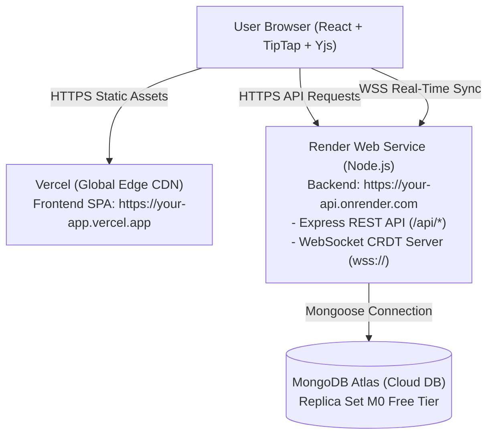

# Deployment Guide: Render (Backend) & Vercel (Frontend)

This guide walks you through deploying **CollabSpace** into production using **Render** for the backend API & real-time WebSocket server, **MongoDB Atlas** for database persistence, and **Vercel** for the React frontend.

---

## Architecture Overview



---

## Step 1: Set Up MongoDB Atlas (Free Cloud Database)

Render web services are stateless, so persistent MongoDB data requires a hosted database.

1. Go to [MongoDB Atlas](https://www.mongodb.com/cloud/atlas/register) and create a free account.
2. Create a new cluster selecting the **M0 Free Tier** (choose AWS or Google Cloud in your preferred region).
3. **Database Access**: Under *Security > Database Access*, click **Add New Database User**:
   - Authentication Method: **Password**
   - Create a username and strong password (save these for the connection string).
   - Built-in Role: **Read and write to any database**.
4. **Network Access**: Under *Security > Network Access*, click **Add IP Address**:
   - Select **Allow Access from Anywhere** (`0.0.0.0/0`) so Render's cloud servers can connect.
5. **Get Connection String**:
   - Go to *Databases > Clusters*, click **Connect** on your cluster.
   - Select **Drivers** (Node.js).
   - Copy the connection string format:
     ```text
     mongodb+srv://<username>:<password>@cluster0.xxxxx.mongodb.net/collab_editor?retryWrites=true&w=majority
     ```
   - Replace `<username>` and `<password>` with your credentials, and specify `/collab_editor` as the database name.

---

## Step 2: Deploy Backend to Render

CollabSpace is preconfigured with single-port HTTP + WebSocket upgrade support, allowing both the Express API and the Hocuspocus CRDT WebSocket server to share Render's public port seamlessly.

### Method A: Blueprint Deploy (Recommended)

1. Log into your [Render Dashboard](https://dashboard.render.com).
2. Click **New +** and select **Blueprint**.
3. Connect your GitHub repository `jaswanthramadasappa-lab/collab-editor-project`.
4. Render will automatically detect the [render.yaml](file:///c:/Users/R.jaswanth/Downloads/collab-editor-project/collab-editor/render.yaml) configuration file.
5. Provide the required environment variables:
   - `MONGODB_URI`: Paste your MongoDB Atlas connection string from Step 1.
   - `CLIENT_URL`: Put `http://localhost:5173` for now (you will update this with your Vercel URL in Step 4).
   - `JWT_SECRET`: Render generates a secure secret automatically.
6. Click **Apply**.

### Method B: Manual Web Service Deploy

If you prefer to configure manually:
1. Click **New +** > **Web Service**.
2. Connect your GitHub repository.
3. Configure settings:
   - **Name**: `collab-editor-api`
   - **Root Directory**: `server`
   - **Runtime**: `Node`
   - **Build Command**: `npm install`
   - **Start Command**: `node src/index.js`
   - **Instance Type**: `Free`
4. Add **Environment Variables**:
   | Key | Value | Description |
   |---|---|---|
   | `NODE_ENV` | `production` | Production mode |
   | `MONGODB_URI` | `mongodb+srv://...` | Your MongoDB Atlas connection URI |
   | `JWT_SECRET` | *32+ random characters* | Random signing secret |
   | `JWT_EXPIRES_IN` | `1d` | Token expiration |
   | `CLIENT_URL` | `https://your-app.vercel.app` | Allowed frontend origin |
5. Add **Health Check Path**: `/api/health`.
6. Click **Create Web Service**.

Once deployed, copy your Render URL: `https://<your-service-name>.onrender.com`.

Verify backend health by opening `https://<your-service-name>.onrender.com/api/health` in your browser. You should see:
```json
{
  "status": "ok",
  "service": "collab-editor-api",
  "database": "connected"
}
```

---

## Step 3: Deploy Frontend to Vercel

1. Log into your [Vercel Dashboard](https://vercel.com/dashboard).
2. Click **Add New...** > **Project**.
3. Import your GitHub repository: `jaswanthramadasappa-lab/collab-editor-project`.
4. In the project configuration:
   - **Framework Preset**: `Vite`
   - **Root Directory**: `./` (leave default, the included root `vercel.json` configures the build) or set to `client`.
5. Under **Environment Variables**, add:
   | Key | Value | Notes |
   |---|---|---|
   | `VITE_API_URL` | `https://<your-service-name>.onrender.com` | Your deployed Render backend URL |
   | `VITE_COLLAB_URL` | `wss://<your-service-name>.onrender.com` | Secure WebSocket URL for live Yjs CRDT collaboration |

6. Click **Deploy**.

Vercel will build the React application and deploy it to a global edge URL (e.g., `https://collab-editor-project.vercel.app`).

---

## Step 4: Final Connection & Verification

1. **Update Render Allowed Origin**:
   - Return to your [Render Dashboard](https://dashboard.render.com).
   - Navigate to your `collab-editor-api` Web Service > **Environment**.
   - Update `CLIENT_URL` with your actual Vercel URL (e.g., `https://collab-editor-project.vercel.app`).
   - Save changes (Render will trigger an instant restart).

2. **Verify End-to-End Collaboration**:
   - Open your Vercel URL in Window 1 and register an account (`Alice`).
   - Create a new document.
   - Open an incognito/private browsing window in Window 2 and register a second account (`Bob`).
   - In Window 1, click **Share Document** and share with Bob's email as **Editor**.
   - Open the shared document in Window 2.
   - Notice:
     - Both online avatars appear in the real-time presence header.
     - Live cursor positions with colored name tags follow each user's selection in real time.
     - Keystrokes, formatting (bold, headings, bullet lists), and edits sync instantly without page refresh!
